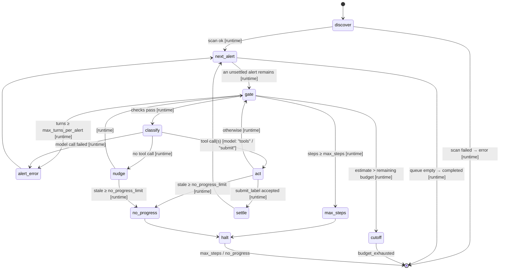
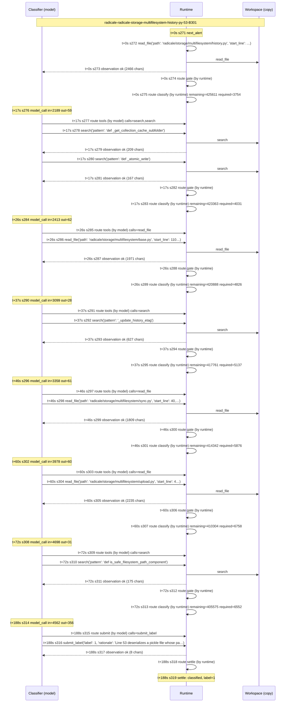

# HW1 design report: a bounded agent for Bandit alert classification

COMS E6998-019, Fall 2026. The agent is `sio2`; how to run it is in
[README.md](README.md). Code references are to `src/sio2/`.

The agent works in two stages. **Discovery** runs Bandit 1.9.4 over the
configured scope, once. **Classification** walks the alerts in report order. For
each alert, a local model (`qwen3.8` on Ollama) investigates the code with
read-only tools and proposes a label. The runtime checks that label before it
writes the row. All of this is one LangGraph state machine. The model chooses
only which tool to call next. The runtime decides everything else: when a model
call may happen, whether a proposal is accepted, and when an alert or the run
ends.

---

## A1. Behaviours

**What the agent does for each alert**

1. **Focus.** It moves the alert into focus (`next_alert`). On OWASP, it
   withholds every other benchmark case from the workspace (A7).
2. **Opening read.** The runtime reads the alert's flagged lines ±20 through the
   dispatcher, as a `read_file` with `requested_by: "runtime"`. The model starts
   from the Bandit finding plus the code around it, so most alerts need no extra
   read.
3. **Investigation.** Before every model call, the runtime checks the step
   failsafe, the token budget and the alert's turn cap (`gate`). If they pass,
   it calls the model. The model picks a tool: `read_file`, `search` or
   `list_dir` to investigate, or `submit_label` to answer. The dispatcher
   validates each request and runs it. It writes the observation the model
   reads next, ending with a runtime note: "You have used k of 8 model turns on
   this alert".
4. **Submission.** `submit_label` carries a label (1 or 0), a rationale and
   evidence ranges. The dispatcher accepts it only if every evidence range lies
   inside lines that an observation in this alert actually showed the model.
   The runtime then writes the row as `classified` (`settle`).
5. **Pacing and failure.** The last 2 of the alert's 8 turns
   (`agent.submit_only_turns`) offer only `submit_label`, with an instruction to
   submit from what has been read. On those turns the dispatcher refuses any
   other tool. The alert ends as `error` if 8 calls pass without an accepted
   submission, or if a model call fails. The alert ends as
   `budget_exhausted` if the budget cannot cover the next call.

**What the agent must never do, and what enforces it**

| Never | Enforced by |
|---|---|
| Run target code | No tool executes anything from the target. Bandit is a static analyser and is runtime-only. The model's four tools only read files, search text and list directories (`tools/files.py`), or propose a label (`tools/submit.py`). There is no shell tool. |
| Write to the target | The model works in a disposable copy (`workspace.py`) and has no write tool. `--input` is only read: it is copied (without `.git`), and `git rev-parse HEAD` reads its commit. Bandit runs on the copy. A test compares every file of the input outside `.git` byte for byte before and after a run (`test_input_checkout_is_untouched_by_a_run`). |
| Invent observations | Only the dispatcher writes `tool` messages. The model's own text is never treated as an observation. `submit_label` refuses evidence the model was never shown: the runtime keeps a ledger (`EvidenceLedger`, `tools/base.py`) of the line ranges each `read_file` and `search` result displayed for this alert. Every cited range must lie inside the union of those ranges. A range that spans two adjacent reads is accepted. A range that crosses an unread gap or runs past the last line read is refused (`test_evidence_must_lie_inside_lines_shown`). The check uses the ledger as it stood when the model wrote its reply, so a `read_file` in the same reply as the `submit_label` does not count: the model had not seen that output yet (`test_submit_cannot_cite_a_read_from_the_same_reply`). `read_file` stops adding lines before the observation would exceed its 11,000-character budget, so the ledger records only lines that actually appear in the observation. One approximation: a line longer than 300 characters is shown clipped but recorded as seen. |
| Read the answer key or a case's safe twin | Withholding plus the single path check (A7). |
| Exceed the budget it was given | The pre-call gate (A6). |

---

## A2. State machine



The per-alert loop is `gate → classify → act → gate`. Every model call passes
through `gate`, so the budget, step and turn checks cannot be skipped. An
alert leaves the loop by one of three routes:

- `settle`, with a classified row;
- `alert_error`, with an error row, after which the next alert starts;
- `cutoff` or `halt`, which settle every remaining row and end the run.

A crash anywhere is handled outside the graph (A6).

---

## A3. Nodes and edges

**Nodes** (`graph.py`, class `Agent`). Every node adds 1 to `steps`.

| Node | Kind | What it does |
|---|---|---|
| `discover` | runtime | Runs the `bandit` tool once through the dispatcher (`requested_by: runtime`). It parses, normalises and sorts the alerts and assigns `alert_id`s. |
| `next_alert` | runtime | Moves `cursor` to the next unsettled alert. It changes the OWASP focus, makes a fresh tool context (evidence ledger), does the opening `read_file` and resets the conversation. |
| `gate` | runtime | No-op body. Its edge function makes the pre-call checks. |
| `classify` | model | One `/api/chat` call. It records `model_call` with the usage Ollama reported. On the alert's last `submit_only_turns` (2) turns, only `submit_label` is offered, and a user message asks the model to submit. |
| `act` | runtime (dispatcher) | Runs each requested tool call in order and appends one observation per call. It stops at an accepted `submit_label`; any later calls in the same reply are not run, and a `state_change` lists them (`skipped_calls`). It updates `stale`. |
| `nudge` | runtime | The reply had no tool call. It appends an instruction to use a tool, and `stale += 1`. |
| `settle` | runtime | Writes the `classified` row from the accepted submission, with its `state_change`. |
| `alert_error` | runtime | Writes an `error` row (turn cap reached or model call failed), with its `state_change`. |
| `cutoff` | runtime | Writes every unsettled row as `budget_exhausted` and sets status `budget_exhausted`. |
| `max_steps`, `no_progress` | runtime | Set the terminal status of their failsafe. |
| `halt` | runtime | Writes every unsettled row as `error`, with the failsafe named in the rationale. |

**Edges.** Each conditional edge writes one `routing` event with `decision` and
`by`.

| From | To | Fixed or conditional | Decided by | Condition |
|---|---|---|---|---|
| START | discover | fixed | — | — |
| discover | next_alert / END | conditional | runtime | Bandit tool ok / failed |
| next_alert | gate / END | conditional | runtime | unsettled alert left / none |
| gate | max_steps | conditional | runtime | `steps ≥ budget.max_steps` (checked first) |
| gate | cutoff | conditional | runtime | `estimate > max_tokens − used` |
| gate | alert_error | conditional | runtime | `turns ≥ max_turns_per_alert` |
| gate | classify | conditional | runtime | all checks pass |
| classify | act (`tools`) | conditional | **model** | the reply asked for investigation tools |
| classify | act (`submit`) | conditional | **model** | the reply called `submit_label` |
| classify | nudge | conditional | runtime | the reply has no tool call (including one cut off by the output allowance before any call was complete) |
| classify | alert_error | conditional | runtime | the model call raised (HTTP or usage missing) |
| act | settle | conditional | runtime | the dispatcher accepted a `submit_label` |
| act | no_progress | conditional | runtime | `stale ≥ no_progress_limit` |
| act | gate | conditional | runtime | otherwise |
| nudge | no_progress / gate | conditional | runtime | `stale ≥ no_progress_limit` / otherwise |
| settle, alert_error | next_alert | fixed | — | — |
| max_steps, no_progress | halt | fixed | — | — |
| cutoff, halt | END | fixed | — | — |

The model decides only the `classify` edge, by choosing between investigating
and submitting. Even a submission is a proposal: `act → settle` is a runtime
decision that follows the dispatcher's validation.

---

## A4. Agent state

`AgentState` (`graph.py`) is the LangGraph state. Reducers are the functions
LangGraph uses to merge a node's update into the state.

| Field | Reducer | Lifetime | Written by | Model sees it? |
|---|---|---|---|---|
| `alerts` | replace | run | `discover` | Only the current alert's fields, inside the opening message |
| `cursor` | replace | run | `next_alert` | no |
| `rows` | `merge_rows`: merge by `alert_id`; **write-once** (a second write raises) | run | `settle`, `alert_error`, `cutoff`, `halt` | no |
| `messages` | `append_or_reset`: append; a `NewConversation` list replaces it | alert (reset by `next_alert`) | `next_alert`, `classify`, `act`, `nudge` | **yes**: this is the model's whole context |
| `usage` | `add_usage`: per-counter sum | run | `classify`, from provider-reported usage | no |
| `steps` | `operator.add` (each node returns 1) | run | every node | no |
| `turns` | replace | alert | `classify` (`next_alert` resets it) | Yes, as text: the opening message states the cap, and `act` appends "used k of N turns" to each turn's observations |
| `stale` | replace | alert | `act`, `nudge` (reset by `next_alert`) | no |
| `signatures` | replace (node appends) | alert | `act` | no |
| `pending` | replace | one turn | `classify` writes it, `act` empties it | no; it *is* the model's request |
| `submission` | replace | alert | `act` | no |
| `alert_reason` | replace | alert | `classify`, `act` | no; it feeds `nudge` and error rationales |
| `status`, `status_reason` | replace | run | `discover`, `cutoff`, `max_steps`, `no_progress` | no |

Some runtime-held objects are not graph state because they are services, not
data:

- the `Trace` (its `usage` mirror accumulates from the `model_call` lines
  written);
- the `Workspace` (which files are withheld now);
- the per-alert `Toolbox`, the model's tools bound to that alert's workspace,
  with its `EvidenceLedger` of displayed line ranges, which backs the evidence
  check.

The model sees none of them.

---

## A5. Tools

Each tool is a class (`tools/`), in the style of cyberbird's `event_driven`
tools. A subclass of `Tool` sets `name`, a one-line docstring (the description
the model reads), and `properties` and `required` (its argument schema), and
writes `run()`. `Tool.schema()` builds what the model is shown from the same
class that runs the tool, so the description cannot drift from the code.
`WorkspaceTool` adds the binding to one alert's workspace and evidence ledger,
and the single path check. `Toolbox` binds the four model tools to an alert
and says which are offered on a turn. Every request goes through
`Dispatcher.run` (`dispatch.py`):

1. It writes `tool_request`.
2. It validates the arguments against the tool class's JSON Schema
   (`Tool.parameters()`), the runtime's own requests included.
3. It runs the tool.
4. It writes `tool_result` immediately after the request.

Unknown tools, tools not offered on this turn (anything but `submit_label` on
a submit-only turn), non-object arguments, schema violations, refusals and even
tool exceptions all become `ok: false` observations prefixed `REFUSED:`. None of them
raises into the graph. Every observation is capped at 12,000 characters. Every
path argument goes through the one check, `Workspace.resolve` (A7).

**`read_file(path, start_line=1, end_line=start+119)`**
- **Does:** returns numbered lines and adds the range to the evidence ledger.
- **Limits:**
  - at most 120 lines per call, and at most 11,000 characters of body: it
    stops at whichever comes first, says where it stopped, and records only
    the lines shown;
  - lines over 300 characters are truncated;
  - files over 2 MB are refused.
- **Refuses:**
  - a path that fails `resolve`, a missing path or a directory;
  - binary files (a NUL byte in the first 8 KB);
  - `start_line < 1`, `start_line` past the end of the file, or
    `end_line < start_line`;
  - extra or ill-typed arguments.

**`search(pattern, path=".", glob="**/*.py", regex=false)`**
- **Does:** returns `path:line: text` matches for a literal (or a regex) under a
  file or directory, and adds each hit line to the ledger.
- **Limits:**
  - at most 30 hits, after which the output says it stopped;
  - pattern of 1 to 200 characters;
  - symlinks and files over 2 MB are skipped;
  - each candidate file passes `resolve`, so withheld files never match.
- **Refuses:**
  - an invalid regex;
  - a `glob` that is absolute or contains `..`;
  - a `path` that fails `resolve` or does not exist.

**`list_dir(path=".")`**
- **Does:** lists a directory's entries, marking folders with `/`.
- **Limits:** 150 entries are shown (the output gives the count of the rest);
  withheld entries are not listed.
- **Refuses:** a path that fails `resolve`, or a path that is not a directory.

**`submit_label(label, rationale, evidence[])`**
- **Does:** proposes the classification. The dispatcher validates the proposal,
  and `settle` writes the row.
- **Limits:**
  - `label ∈ {0, 1}`;
  - a non-empty rationale of at most 1,500 characters;
  - 1 to 5 evidence ranges.
- **Refuses:**
  - any evidence whose `path` fails `resolve`;
  - `start_line > end_line`;
  - a cited range that is not inside lines an observation showed in this alert.
    The refusal lists the ranges the model *has* seen, so it can correct itself.

**`bandit(paths, exclude, min_severity)`**, runtime only. It is not in the
model's tool list, and a model request for it gets "unknown tool".
- **Does:** the work in `tools/scan.py` (`BanditScan`, around `run_bandit`):
  - expands the `paths` globs relative to the checkout;
  - builds `bandit -q -r --severity-level medium [-x …] -f json -o <tmp> <paths>`,
    with no confidence flag;
  - runs it from the root of the copy;
  - parses the JSON, strips `./`, re-filters to severity ≥ MEDIUM, sorts by
    (path, line, test_id) and assigns ids.
- **Refuses:**
  - `bandit --version` other than the configured 1.9.4;
  - a scan path that matches nothing;
  - an exit status other than 0 or 1 (1 only means results were found);
  - output that is missing or is not JSON.

---

## A6. Start, stop and termination

**Start.** The CLI loads the TOML and validates it against
`config.schema.json`. An invalid config exits 1 before any run starts, so it
leaves no trace. The CLI then opens the workspace and writes a `start`
`state_change` (input, commit, budget and the files withheld for the run).
Finally it streams the graph.

**Terminal statuses.** These are closed and mutually exclusive. Exactly one is
written, last.

| Status | Triggered when | Unsettled rows become |
|---|---|---|
| `completed` | `next_alert` finds no unsettled alert. Each row reached `classified` or an alert-level `error` on its own path. | — (none left) |
| `budget_exhausted` | `gate` finds the next call's estimate larger than the remaining budget. | `budget_exhausted` |
| `max_steps` | `gate` finds `steps ≥ budget.max_steps`. | `error` ("run stopped by the max_steps failsafe") |
| `no_progress` | `no_progress_limit` (3) model turns in a row produced no new observation. That is, every call was refused or repeated a call already made on this alert, or there was no tool call. | `error` |
| `error` | Bandit failed (no rows), an exception escaped the graph (including Ctrl-C, and SIGTERM, which the CLI turns into an exception), or `report.json` failed schema validation or could not be written. | `error` ("run crashed …") |

Precedence inside `gate`: `max_steps` is checked before the budget, and the
budget before the turn cap. So exactly one status applies even if several
conditions hold at once. `completed` can therefore include alert-level
`error` rows (the turn cap was reached, or a model call failed): the *run*
ended normally even though some alerts did not.

**Crash path** (`cli.run`). The order below keeps the invariants on a crashed
run:

1. Any exception escaping the graph is caught, `KeyboardInterrupt` included.
   If it struck inside a tool, the dispatcher has already written that
   request's `tool_result` (`interrupted: …`) before re-raising, so invariant 6
   holds. (If the interrupt lands while the request line itself is being
   written, the request never reaches the trace, so no unpaired line remains.)
2. The CLI writes a `crash` `state_change` with the traceback.
3. It takes the rows already settled in the trace. That includes rows a node
   wrote just before failing, which LangGraph never committed to state
   (`Agent.written_rows`), so no alert is settled twice (invariant 5).
4. It writes an `error` row, each with its own `state_change`, for every alert
   still unsettled. The alert list comes from state, or, if discovery finished
   but LangGraph had not yet committed its update, from `Agent.discovered`. So
   a crash right after discovery still reports every alert.
5. It writes `report.json`, validated against the schema before writing and
   replaced atomically.
6. It writes the `terminal` event, last (invariant 3).

Tests: `test_crash_still_writes_report_and_terminal`,
`test_interrupt_inside_a_tool_keeps_invariants`, and
`test_failure_while_settling_in_bulk_settles_each_row_once`, and
`test_crash_right_after_discovery_still_reports_every_alert`. The
bulk-settling test fails inside `cutoff` or `halt` both before and after the
rows reach the trace.

Every terminal event carries a `reason`:
- for `max_steps`, the limit reached;
- for `no_progress`, the number of fruitless turns;
- for `budget_exhausted`, why the gate cut off;
- for `error`, the exception.

**Budget policy.**
- **The charge.** It is `input + output` as Ollama reported them for each call
  (`prompt_eval_count` and `eval_count`), summed over every `model_call`.
  `cache_read` (`prompt_eval_cached_count`) is recorded but never charged.
  Nothing is estimated in the charge. If Ollama omits a counter, the call is
  treated as failed (`ModelError`) rather than charged a guess.
  `budget.used_tokens` in `report.json` and `usage_total` in the terminal event
  are both computed from the same `model_call` events.
- **When it is checked.** Before every model call, in `gate`, which every path
  to `classify` passes through.
- **How it is checked.** `required = ceil(chars(JSON of the messages and tools
  sent) / 3) + output_allowance`, and the call is made only if
  `required ≤ max_tokens − used`. Three characters per token is deliberately
  pessimistic. Across all 349 model calls in the 9 committed runs, the ratio
  worked back from each gate's `required` and the call's reported `input` was
  3.2 to 3.9, and no call's reported charge exceeded its `required`.
  So in practice `used_tokens` stays at or under `max_tokens`; the estimate
  could still undershoot on unusual text. The estimate only gates; it is never
  charged.
- **How the output allowance is sent.** On every request, as
  `options.num_predict = output_allowance`, Ollama's hard cap on generated
  tokens. If a reply that hits it (`done_reason: "length"`) carries no
  complete tool call, the runtime nudges the model to be brief, which counts
  toward `no_progress`. Complete tool calls in a cut-off reply are dispatched
  and validated like any others: the content is never parsed for a label, and
  only an accepted `submit_label` settles a row.
- **At the cutoff.** `cutoff` settles the current alert and every later one as
  `budget_exhausted` (label `null`, one `state_change` each). It sets
  `budget.exhausted: true` and ends the run with status `budget_exhausted`. The
  model is not called again. With `max_tokens = 0`, no model call is made at
  all (`test_zero_budget_makes_no_model_call`).

**Other failsafes.**
- `max_steps` counts graph node executions. It is checked in `gate` before every
  model call.
- The no-progress detector (`stale`) counts consecutive turns that produced no
  new observation.
- `max_turns_per_alert = 8` is an alert-level cap: reaching it turns that one
  alert into an `error` row, and the run moves on. The last
  `submit_only_turns = 2` of them offer only `submit_label`.
- SIGTERM is caught and raised as an exception, so `kill <pid>` takes the crash
  path above. SIGKILL (`kill -9`) cannot be caught by any process: its trace
  ends at the last flushed event, with no terminal line. That is the one case
  where invariant 3 cannot hold.
- LangGraph's own recursion limit is set to `max_steps + 100`, so our failsafe
  fires first.

---

## A7. Workspace and withholding

**The copy.** `Workspace.__enter__` copies `--input` into a fresh temporary
directory, `…/sio2-ws-*/repo`. It copies symlinks as links and skips
`.git`. Withheld files go to a sibling `…/withheld` directory, *outside* the
copy, so no tool path can reach them. On exit, withheld files are moved back
and the whole temporary tree is deleted (`agent.keep_workspace = true` keeps it
for inspection, complete again). `--input` is never written to.

**The one path check.** `Workspace.resolve(path)` is the only way a tool turns
an argument into a file. It refuses:

- an empty or non-string path;
- an absolute path (`/…` or a drive letter);
- any `..` component;
- anything that, after `Path.resolve()` (which follows symlinks), is not
  `is_relative_to(root)`, such as a symlink pointing outside the copy;
- any resolved path matching a withheld pattern (defence in depth, in case a
  withheld file were present).

`search` also runs each candidate file through `resolve`, and `list_dir` hides
withheld entries.

| Target | Withheld | Why | How | Restored |
|---|---|---|---|---|
| all | `.git/` | The history of a full clone can hold commits made after the pinned one, including the fixes. | never copied, plus a pattern refusal in `resolve` | Nothing to restore: the original `.git` is untouched. |
| OWASP | `expectedresults*.csv` | It is the answer key. | moved to the stash when the workspace opens | moved back on exit |
| OWASP | `results/` | Other scanners' published outputs for this benchmark, including a Bandit SARIF and a Bearer report. They are not labels, but they are scorecard material, which no real triage would have. This is our own judgement; the brief does not require it. | moved to the stash when the workspace opens | moved back on exit |
| OWASP | every `testcode/BenchmarkTest*.py` and `templates/web/*/BenchmarkTest*.html` except the case under investigation | Each case has a safe twin implementing the same endpoint. Reading the twin is pattern-matching a neighbour, not analysis. | `focus(path)` per alert moves the other ~1,229 cases to the stash. It first restores the previous alert's set. | by `unfocus()` before the next focus, at the end of the queue, at cutoff or halt, and on exit |
| Radicale, SGLang | `.git/` only | No answer key ships in these repositories. | as above | as above |

`helpers/` on OWASP is deliberately **not** withheld. Following a value into
`helpers/utils.py` is the investigation we want. `test_owasp_withholding_and_restore`
checks these behaviours:

- the key is refused;
- only the focused case is listed;
- switching cases restores the previous set;
- everything is back on exit.

Discovery runs before any focus. It scans the full required scope, as the brief
requires, because it runs on the copy with only the run-level files (key,
`results/`) withheld, and neither is in the scan scope.

---

## C2. Results

The runs in the tables below used the config committed beside each run, as
`runs/<run>/config.toml`. Two runs are kept as evidence of earlier revisions,
each with a `NOTE.md` saying exactly how that code differed:
`runs/dev-baseline` (prompt v1) and `runs/radicale-pre-pacing` (before turn
pacing).

After the last of these runs, we made four small changes, all found by our own
grading pass:
- the evidence check ignores reads made in the same reply as the submission;
- `read_file` caps its body at 11,000 characters;
- float arguments are refused;
- two crash windows were closed (A6).

None of these paths occurs in any committed trace. No read in any trace is
over 6,900 characters, no reply mixes `submit_label` with another call, and no
argument is a float. Rerunning `radicale-low` on the final code reproduced the
committed trace event for event: the same 53 steps, decisions, labels and
charged tokens. The only difference was `cache_read`, which reflects Ollama's
server-side prompt cache and is never charged. The tables are computed from the committed
traces by `scripts/summarise_runs.py`; none of the numbers were typed by hand.
`uv run python -m sio2.check runs/<run>` passes on every run (the
schemas and all six invariants).

### Label counts for each target and config

| Run | Rows | Label 1 | Label 0 | `null` | Statuses | Terminal | used / max tokens | Model calls | Refusals | Wall time |
|---|---|---|---|---|---|---|---|---|---|---|
| `radicale-full` | 10 | 8 | 2 | 0 | classified 10 | `completed` | 261,600 / 600,000 | 59 | 0 | 28.5 min |
| `radicale-low` | 10 | 1 | 1 | 8 | classified 2, budget_exhausted 8 | `budget_exhausted` | 9,280 / 15,000 | 4 | 0 | 1.1 min |
| `owasp-full` | 18 | 12 | 6 | 0 | classified 18 | `completed` | 94,423 / 600,000 | 39 | 2 | 18.8 min |
| `owasp-low` | 18 | 0 | 3 | 15 | classified 3, budget_exhausted 15 | `budget_exhausted` | 11,265 / 15,000 | 5 | 0 | 2.6 min |
| `sglang-full` | 21 | 11 | 10 | 0 | classified 21 | `completed` | 466,591 / 600,000 | 117 | 3 | 74.3 min |
| `sglang-low` | 21 | 0 | 0 | 21 | budget_exhausted 21 | `budget_exhausted` | 12,603 / 15,000 | 4 | 0 | 1.1 min |
| `radicale-max-steps` | 10 | 2 | 1 | 7 | classified 3, error 7 | `max_steps` | 41,561 / 600,000 | 11 | 0 | 14.8 min |

- **Full configs.** Every alert on every target is classified. No full run
  touched the budget or a failsafe.
- **Low configs** (`max_tokens = 15000`). Every low run ends
  `budget_exhausted`, with `budget.exhausted: true`. The gate refuses the
  first call whose estimate exceeds what is left, and every unsettled row,
  including the alert in progress, becomes `budget_exhausted`.
  - **Radicale** classifies 2 alerts before the cutoff (the run B7 checks).
  - **OWASP** classifies 3.
  - **SGLang** classifies none: its first alert spent 12,603 tokens across
    4 calls investigating, and the gate cut it off before it submitted.
- **`radicale-max-steps`** shows the other failsafe on a real run:
  `configs/demo-max-steps.toml` is the full config with `max_steps = 40`. The
  run ends `max_steps` after classifying 3 alerts. The 7 rows it never settled
  are `error`, each with the rationale "run stopped by the max_steps failsafe
  before this alert was classified". The CLI exits 2.
- **No-progress.** The detector never fired in a real run, because the model
  never refused or repeated itself three turns in a row. It is exercised
  deterministically by `test_no_progress`: a scripted model repeats a refused
  path, and the run ends `no_progress` after exactly 3 model calls.

### OWASP BenchmarkPython against the benchmark's labels

`scripts/evaluate_owasp.py` scores a report against `expectedresults-0.1.csv`.
It reads the key from the real checkout; the agent never sees it. Label 1 is the
positive class, and the truth for a row is the "real vulnerability" flag of the
test case its file belongs to. Of the 18 alerts, 8 are real vulnerabilities and
10 are safe twins.

| Run | Prompt | TP | FP | TN | FN | Precision | Recall |
|---|---|---|---|---|---|---|---|
| `runs/dev-baseline` | v1 (earlier code: final turn only submit-only, no turn note) | 8 | 5 | 5 | 0 | 0.615 | 1.000 |
| `runs/owasp-full` | v2 (submitted) | 8 | 4 | 6 | 0 | 0.667 | 1.000 |

**How we used the labels to refine the agent.** We used the key in exactly
one place: reading the five false positives of the development baseline and
asking *why* the model was wrong, not *which* answer was right. Every error
was a label-1 call on a safe twin, and the rationales showed three general
mistakes:

1. **An invented attacker ability.** On `BenchmarkTest00016` (B314), the model
   argued that an attacker could control the working directory, making the
   constant path `./helpers/resources/employees.xml` attacker-chosen.
2. **A validation bypass the language does not allow.** On `00073` (B307,
   `eval`) and `00075` (B102, `exec`), the input is checked to be a single
   quoted string literal. The model claimed escape sequences would let code
   through; in Python 3, evaluating such a literal only yields a string.
3. **XXE assumed for parsers that do not resolve external entities.** On
   `00017` (B317 and B318), the model assumed `xml.sax` and `minidom` resolve
   external entities by default; since Python 3.7.1 they do not.

We added a short "Calibrate before you label 1" section to the system prompt
(`prompts/system.md`) stating these three facts in general terms: no Benchmark
names, test ids or answers. We did not tune anything else against the key: not
the opening read, the turn caps, nor the per-test-family hints.

**Result.** One of the five false positives went away (`00016`); recall stayed
at 1.000. The other four survived explicit guidance. On `00073`, the model now
claims a bypass through backticks, which are Python 2 syntax and do not
execute in Python 3. On `00017`, it ignores the comment in the case itself
("all features are disabled by default"). We stopped there. Further rounds
would have meant writing these cases' answers into the prompt, which would
measure memorisation, not generalisation.

**Why the OWASP labels and our prompt sometimes disagree on purpose.** All
five MD5/SHA1 cases (B324) are labelled vulnerable in the benchmark, and our
agent labels them 1. The prompt's rule is not "weak hash means 1", though: a
weak hash used for a non-security purpose gets 0. That is how the agent labels
Radicale's `hook/email` SHA1, which only compares two event dictionaries for
equality.

### Held-out targets

There are no keys for Radicale and SGLang, so we report counts only (table
above). Two observations from the traces:

- **Shared data flows are re-derived per alert.** All four Radicale
  `sharing/files.py` pickle alerts were labelled 1. Each re-derived the same
  data flow (share path → `_encode_path` → the pickle file written by
  `database_create_sharing`) from scratch, at about 7 model calls each (C3).
- **The turn pacing does real work.** On Radicale, 8 of 10 alerts used all six
  open turns and submitted on turn 7, the first submit-only turn. Before the
  turn note and the submit-only turns existed, 5 of 10 Radicale alerts ended
  as `error` (`runs/radicale-pre-pacing`, committed with a NOTE.md on the
  earlier code).
  On its last turn, with only `submit_label` offered, the model kept calling
  `read_file`.

### Cost and latency

| Run | Median model calls per classified alert | Median tokens per classified alert | Median seconds per classified alert |
|---|---|---|---|
| `radicale-full` | 7 | 28,340 | 199 |
| `radicale-low` | 1.5 | 3,556 | 27 |
| `owasp-full` | 2 | 4,805 | 63 |
| `owasp-low` | 1 | 2,075 | 51 |
| `sglang-full` | 7 | 27,035 | 200 |
| `sglang-low` | 0 | 0 | 0 |
| `radicale-max-steps` | 2 | 5,023 | 153 |

Investigating costs much more than the opening read. On OWASP, the deciding
code is usually in the case file itself or one `helpers/` module away: a median
of 2 calls and about 4,800 tokens per alert. On Radicale and SGLang, the model
uses its whole investigation allowance on most alerts: a median of 7 calls,
about 27,000–28,000 tokens and about 200 s per alert. The output side is small:
a median of about 60 tokens per investigating call and 200–310 per submission. Input
dominates, because each call re-sends the alert's growing conversation.

### One alert's trajectory

`radicale/storage/multifilesystem/history.py:53` (B301, `pickle.load`) from
`runs/radicale-full/trace.jsonl`, drawn by:

```bash
uv run python -m sio2.trajectory runs/radicale-full/trace.jsonl \
  radicale-radicale-storage-multifilesystem-history-py-53-B301
```

How to read it:
- **Runtime steps.** `R->>R` lines are the runtime's own decisions and its
  opening read. Each `route classify` line shows the budget gate's `remaining`
  and `required`.
- **Model steps.** `M->>R` lines are the model's proposals: a `route` decided
  by the model, followed by the requests it made.
- **Observations.** `R-->>M` lines are observations the runtime wrote. The `s`
  numbers are trace steps.

The model searched for and read the cache-path helper, the history writer and
the path-sanitising helper across four files. With 6 of 8 turns used, its next
reply (turn 7, submit-only) submitted label 1, and the runtime settled the row.



---

## C3. Limitations and alternatives

### Limitations of this agent

- **One model, small and local.** `qwen3.8` (27B, Q4) runs with reasoning off.
  It reads code carefully, but it over-weights speculative attacks (C2,
  development run 1). It also cannot tell a benchmark's intended label from
  real-world risk. The OWASP labels mark every MD5 or SHA1 use as vulnerable,
  whatever the hash is used for, and our prompt's rule (a non-security use
  gets 0) is the one we want on Radicale and SGLang.
- **Evidence is checked for provenance, not relevance.** The ledger proves the
  model *saw* the lines it cites. It does not prove those lines support the
  label: a wrong rationale built from real lines passes.
- **One alert at a time, no memory across alerts.** Radicale's four `pickle`
  alerts in `sharing/files.py` share one data flow. Each alert re-derives it
  from scratch, which costs tokens and can produce inconsistent labels for the
  same flow.
- **The budget gate is an estimate.** The estimate never undershot in our
  runs, but it is a character heuristic. A file of very dense tokens could
  make one call's charge exceed `required`, and so exceed `max_tokens` by up to
  that call's error.
- **A dead provider looks like a finished run.** If every model call fails
  (Ollama down), each alert becomes an alert-level `error` row with the HTTP
  error in its rationale. The run still ends `completed` with exit 0, because
  no run-level failsafe counts failed calls. A consecutive-model-failure
  limit, ending the run as `error`, would be the next failsafe to add.
- **`no_progress` ends the whole run.** The rubric asks for its own terminal
  status, and a model that loops on one alert is likely to loop on others.
  Even so, a single stuck alert stops classification of every later alert.
  `max_turns_per_alert` usually catches a stuck alert first, as an alert-level
  error.

### Alternatives (analysed, not built)

**Our cost per alert** (C2): a median of 2 model calls and about 4,800 tokens
on OWASP, and 7 calls and about 27,000–28,000 tokens on Radicale and SGLang,
where the model uses most of its turns.

**Fixed workflow.** The runtime does the same steps for every alert: read
±N lines around the flag, read the enclosing function, resolve the imports it
calls, then make **one** model call that must return the label as JSON.
- **Cost.** It is the lowest and the most predictable: exactly one model call
  per alert, so the budget can be split per alert up front. On our traces, the
  first call alone costs about 2,000 input tokens.
- **Latency.** One call, about 10–20 s on this machine, against our medians
  of 63 s per alert (OWASP) and about 200 s per alert (Radicale, SGLang).
- **Coordination.** None: no routing decisions are left to the model, and the
  trace is linear.
- **Failure behaviour.** It degrades quietly. When the deciding code is
  elsewhere, the model labels from what the runtime chose to show it. Examples
  are a helper in another module (OWASP's `ThingFactory`), or a writer of a
  pickle file in the same module (Radicale `sharing/files.py`, where our model
  needed `search` to find `pickle.dump`). The model cannot ask for more, so it
  guesses. A malformed reply costs only that alert.
- **Fit.** A strong baseline for OWASP, where nearly everything is in one file.
  It is weaker on Radicale and SGLang, where the deciding code was a `search`
  away in about half of our alerts.

**Plan-and-execute.** A planner call writes an investigation plan for the alert
("find the source of `bar`; check the validation; read the sink's
configuration"). An executor carries out each step with tools, and a final
call (or a separate validator) labels.
- **Cost.** It is higher: one planning call plus at least one call per step,
  and replanning when a step fails. It would roughly double our calls per alert
  for the short OWASP cases, where our agent often submits on its second call.
- **Latency.** Higher, for the same reason. Plan steps are independent reads,
  so they could be parallelised, but a single local GPU serialises them anyway.
- **Coordination.** A plan is an explicit artefact to trace and check. The
  runtime can refuse a step that reads a withheld file before it runs, and a
  validator call separates "who proposed the label" from "who accepted it".
  That removes the single-model self-agreement our agent has.
- **Failure behaviour.** A bad plan fails confidently: the executor dutifully
  gathers irrelevant context. Replanning helps, but each replan is another call
  that the budget gate must cover. With our budget policy, a cutoff mid-plan
  leaves an alert half-investigated, which our per-call gate already handles,
  but more calls are wasted.

**Supervisor/worker.** A supervisor holds the alert queue and dispatches each
alert, or each group of related alerts, to worker agents, possibly with
different prompts per Bandit test family. It then merges and reconciles the
results.
- **Cost.** The highest. Every worker pays its own context, and the supervisor
  pays to read the results. It could *save* tokens on related alerts: one
  worker for Radicale's four `sharing/files.py` pickle alerts would trace the
  data flow once.
- **Latency.** Lowest wall-clock *if* workers run concurrently on hosted
  models. On one local GPU it is worse than ours.
- **Coordination.** The hardest of the three. The global budget must be split
  among workers, or reserved per worker, and the step count, the trace order
  and invariant 6 must survive concurrent workers (a single dispatcher becomes
  a queue). The OWASP case isolation also breaks: our per-alert `focus()`
  moves files in a shared copy, so concurrent workers would each need their
  own copy.
- **Failure behaviour.** It isolates failures well (one worker's crash or loop
  costs one alert, not the run). But inconsistent workers disagree, and the
  supervisor's reconciliation step is a new place to invent conclusions no
  tool observed.

**What we would change first.**
- Keep the reactive loop: it is the cheapest design that can still go and
  read the deciding code.
- Add the fixed workflow's richer opening read (the enclosing function, not
  ±20 lines), which would remove most first-turn `read_file` calls.
- Add a validator call for label-1 submissions only. That targets our main
  error, false positives, at a cost of one extra call on about half the
  alerts.
